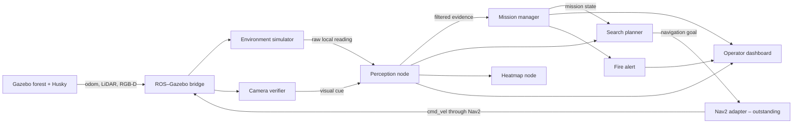

# System architecture

## Design intent

EmberTrace separates ground-truth simulation from robot knowledge. The environment node knows the fire location only so it can generate sensor readings. Perception, decision and search nodes receive the same kind of local measurements a real robot could obtain.

## Packages

| Package | Responsibility | Expected owners |
| --- | --- | --- |
| `embertrace_interfaces` | Stable messages and services shared by all packages | Systems/integration lead |
| `embertrace_sim` | World, robot, sensor bridge, localisation, SLAM, Nav2 and RViz | Simulation/navigation members |
| `embertrace_core` | Environmental model, perception, state machine, search goals and visualisation | Perception/autonomy members |
| `embertrace_ui` | Ranger-facing Qt dashboard | UI/integration member |
| `embertrace_bringup` | Project-wide launch and parameters | Systems/integration lead |

## Runtime nodes

### `environment_simulator_node`

Subscribes to Husky odometry and samples a Gaussian plume at the robot position. It adds seeded noise and publishes raw smoke, temperature and wind readings. This is the only node allowed to know the source coordinates.

### `camera_verifier_node`

Reads the RGB camera and publishes a low-confidence fire-colour cue. It is an educational placeholder for a stronger computer-vision method.

### `perception_node`

Filters raw environmental readings, merges the optional camera cue, calculates detection confidence and publishes a single robot-level perception output.

### `mission_manager_node`

Owns the mission state machine and operator service. It decides when the system transitions from patrol to investigation, tracking, recovery, verification, alert or return.

### `search_planner_node`

Turns state plus local wind/smoke evidence into short investigation goals. The baseline surges upwind when the plume is present and alternates crosswind when it is lost.

### `heatmap_node`

Stores a bounded history of samples and publishes RViz markers. It is for operator awareness only and must not leak ground truth into decision-making.

### `operator_dashboard`

Presents mission status and sends explicit operator commands through a ROS service. ROS callbacks are processed in the Qt event loop, keeping the UI implementation approachable.

## State machine ownership

Only the mission manager publishes `/embertrace/mission_state`. Other nodes request behaviour through inputs and commands; they do not independently change the state. This avoids contradictory decisions during integration.

## Safety boundary

`E_STOP` is latched in the mission manager. The future Nav2 adapter must immediately cancel its goal and publish zero velocity when the state becomes `EMERGENCY_STOP`. Resetting the state must require an explicit operator `RESET` command.

