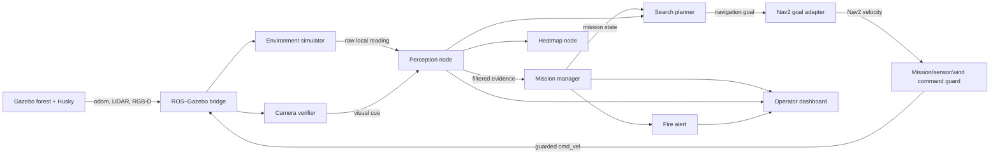

# System architecture

## Design intent

EmberTrace separates ground-truth simulation from robot knowledge. The environment node knows the fire location only so it can generate sensor readings. Perception, decision and search nodes receive the same kind of local measurements a real robot could obtain.

## Packages

| Package | Responsibility | Expected owners |
| --- | --- | --- |
| `embertrace_interfaces` | Stable messages and services shared by all packages | Systems/integration lead |
| `embertrace_sim` | World, robot, sensor bridge, localisation, SLAM, Nav2 and RViz | Simulation/navigation members |
| `embertrace_core` | Environmental model, perception, state machine, search goals and visualisation | Perception/autonomy members |
| `embertrace_ui` | Ranger-facing Qt dashboard | UI/integration member |
| `embertrace_bringup` | Project-wide launch and parameters | Systems/integration lead |

## Runtime nodes

### `environment_simulator_node`

Subscribes to Husky odometry and samples a Gaussian plume at the robot position. It adds seeded noise and publishes raw smoke, temperature and wind readings. This is the only node allowed to know the source coordinates.

### `camera_verifier_node`

Reads the RGB camera and publishes a low-confidence fire-colour cue. It is an educational placeholder for a stronger computer-vision method.

### `perception_node`

Filters raw environmental readings, merges the optional camera cue, calculates detection confidence and publishes a single robot-level perception output.

### `mission_manager_node`

Owns the mission state machine and operator service. It decides when the system transitions from patrol to investigation, tracking, recovery, verification, alert or return.

### `search_planner_node`

Turns state plus local wind/smoke evidence into short investigation goals. The baseline surges upwind when the plume is present and alternates crosswind when it is lost.

### `heatmap_node`

Stores a bounded history of samples and publishes RViz markers. It is for operator awareness only and must not leak ground truth into decision-making.

### `operator_dashboard`

Presents mission status and sends explicit operator commands through a ROS service. ROS callbacks are processed in the Qt event loop, keeping the UI implementation approachable.

## State machine ownership

Only the mission manager publishes `/embertrace/mission_state`. Other nodes request behaviour through inputs and commands; they do not independently change the state. This avoids contradictory decisions during integration.

## Safety boundary

`E_STOP` is latched in the mission manager. The Nav2 adapter cancels its goal, while the command guard immediately inhibits velocity when motion is not allowed. The guard is the only rover cmd_vel publisher in the integrated launch. Resetting the state must require an explicit operator `RESET` command.

## Aerial scout and perception validation

A separate drone model/bridge, environment sampler, camera verifier and local
perception filter publish only measured scout evidence. Aerial detections can
request rover investigation. The search planner selects short goals toward the
sampled aerial location and still enforces known-free occupancy cells. Rover
confirmation and the source fit use rover-local evidence.

Sensor-health nodes report all streams to diagnostics. The rover command guard
and aerial controller require fresh mission/sensor heartbeats. Perception
watchdogs clear stale environmental/visual validity; the mission pauses on
rover environmental dropout. A recorder consumes separate evaluation labels,
and a standalone executable evaluates the same filter used by the live nodes.
The new drone is a kinematic demonstrator, not a rotor-dynamics or hardware
flight-control system. See demo-guide.md and perception-validation.md.

## Deployment and mission lifecycle

The same launch creates three supported deployments. A standalone rover runs the
rover sensor pipeline, guarded Nav2 execution and waypoint patrol. A standalone
aircraft runs only its own sensor pipeline and aerial patrol/investigation
controller. A coordinated deployment runs both, with the rover owning local fire
confirmation. The mission state machine, estimator, operator service and dashboard
are reused with explicit primary-sensor remappings.

Ground search goals must occupy known free map cells with rover clearance. Aerial
search goals use the shared simulation odometry frame and are constrained by the
flight controller's altitude, geofence, LiDAR and heartbeat checks. The aircraft
is a velocity-controlled simulation model, without rotor dynamics or a hardware
autopilot. Wind classification is consumed by both motion controllers.

Search timeout returns the mission to patrol; a persistent dismissed anomaly
cannot immediately retrigger the same investigation. Coordinated return completes
only after both measured home arrivals. Navigation action results are fed back to
the patrol sequencer, which also has bounded retries and pose-based arrival checks.
See [integration evidence](integration-review.md) for validation results.
