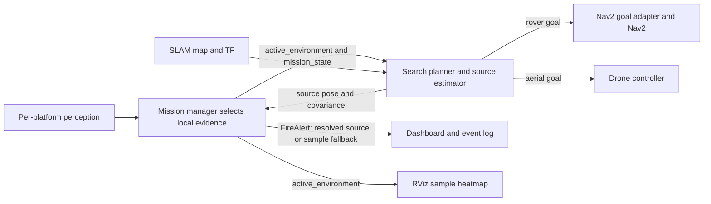

# Search and source estimation — presentation fact sheet

**EmberTrace · Adam's subsection · 5 November 2026**  
Algorithm and interfaces checked against main `3b4f435`. The final showcase update at the end records the latest runtime results. Test results are tied to their recorded revisions.

## The explanation to give first

> “My subsystem turns local environmental readings into an investigation strategy and a source-location estimate. Initially, the robot follows the plume upwind to gather observations. It fits a possible source to measurements collected at different positions, and approaches a downwind stand-off point when that fit is sufficiently certain. If it loses the signal, it searches across the wind to reacquire it. The rover sends map-checked goals to Nav2; the drone uses the same estimator and searches at its flight altitude. The mission manager independently decides whether the sensor evidence confirms a fire and whether the source estimate is good enough to report.”

**Three separate decisions:** detection asks whether there is an anomaly; localisation asks where its source might be; navigation decides how the selected robot can reach an investigation goal. A confirmed fire can still have an unresolved source.

## What I implemented and where it lives

| Component | Responsibility |
| --- | --- |
| `search_planner_node.cpp` | ROS integration, mission state, sampling, upwind probes, crosswind recovery, source stand-off and platform-specific goals |
| `source_estimator.cpp` / `.hpp` | ROS-independent numerical fit and uncertainty from a bounded spatial history |
| `known_free_grid.cpp` / `.hpp` | Occupancy-grid coordinate conversion and clearance-safe rover target selection |
| `embertrace_bringup/config/embertrace.yaml` | Runtime search, field-model, timing, clearance and uncertainty settings |
| `test_search_estimation.cpp` and ROS search integration scripts | Numerical, map and real message-transport regressions |

The subsystem publishes destinations, rather than wheel speeds or rotor commands. Nav2 and the drone controller own execution; mission selection, manual mode, sensor health and E-stop gates remain downstream.

## Integration with the rest of the system

| Interface | Meaning and owner |
| --- | --- |
| **Input** `/embertrace/active_environment` — `EnvironmentalReading` | The manager forwards the selected vehicle's accepted local readings. Includes stamped sample pose, smoke, scalar temperature, wind and detection flags. Both platforms use the shared `husky1_odom` reference in this simulator. |
| **Input** `/embertrace/mission_state` — `MissionState` | Phase, selected platform and mission epoch. A platform/epoch change clears the estimator so observations from different missions are not mixed. |
| **Input** `/husky1/map` — `OccupancyGrid`, plus TF | SLAM geometry for rover goal checking. Samples are transformed from odometry coordinates into the map frame. Missing map/transform withholds rover goals. |
| **Input** `/embertrace/fire_alert` — `FireAlert` | A new confirmed but unresolved incident gives the planner a fresh bounded refinement window. |
| **Output** `/embertrace/source_estimate` — `PoseWithCovarianceStamped` | Best-fit horizontal source and uncertainty. It is a candidate estimate; publication alone does not certify a resolved source. |
| **Output** `/embertrace/navigation_goal` — `PoseStamped` | Rover investigation destination. The adapter validates/transforms it, then calls the namespaced Nav2 action. |
| **Output** `/drone1/navigation_goal` — `PoseStamped` | Drone investigation destination at 8 m altitude. The aerial controller handles motion and local LiDAR stopping. |

The dashboard receives the location through the manager's **FireAlert**, labelled **Source estimate** when resolved and **Detection sample** otherwise. The RViz heatmap separately plots measured smoke samples; it is not a ground-truth source map or a probabilistic source distribution.

## Search behaviour, step by step

1. **Patrol:** collect a bounded history of local measurements while the patrol subsystem moves the vehicle. Search does not replace the normal patrol route.
2. **Investigate/track, uncertain fit:** request a short **upwind** probe. Wind direction denotes where smoke travels, so upwind is `wind_direction + pi`.
3. **Fit becomes usable:** head toward a point **1.2 m downwind of the fitted source**, advancing by at most the configured 2 m surge each update. This maintains plume exposure instead of deliberately aiming into the source centre.
4. **Signal weakens or RECOVER is entered:** alternate crosswind casts about the last detected-signal pose. Sweep amplitudes are 2.5, 2.5, 5, 5, 7, 7… metres, with a 1 m upwind offset. A new detected signal resets the cast sequence.
5. **VERIFY:** publish/refine source estimates but issue no new search movement goals. The manager holds position while seeking corroborating evidence.
6. **Pause/return/stop:** no new search goals in non-search phases. IDLE, RETURN, ALERT and E-stop clear fit history; returning from an investigation to PATROL also clears it. Downstream controllers enforce movement permission and manual/E-stop selection.

**Rover map gate:** a target and its 0.8 m clearance neighbourhood must be known and have occupancy no greater than 20. Unknown cells are rejected. The planner first looks within 2 m of its requested target; uncertain probes/casts can use a surveyed detour within 4 m. Those probes must remain at least 1.5 m from the robot, beyond Nav2's 1 m arrival radius. This checks the goal neighbourhood, **not connectivity of the entire route**; Nav2 must still find and execute the path.

**Drone difference:** no ground-grid snap is applied. The planner uses the bounded horizontal search window and an 8 m flight layer above the supplied forest assets. The drone is an ideal velocity-controlled simulation proxy, not a physical Parrot flight stack.

## How the source estimate is calculated

**Observations:** `(x, y, smoke_ppm, scalar_temperature_C, wind_direction)`. The fit uses local smoke and scalar temperature. **IR pixel peaks and CO2 do not directly enter this numerical fit**; they contribute to perception/confirmation and the detection flags that guide search.

A reading within 0.3 m of the fixed spatial anchor refreshes the last stored sample. Moving beyond that spacing adds a sample, up to 160. This prevents a stationary robot from building false spatial evidence and lets small movements accumulate. Estimation needs at least five samples, at least three informative samples, and a sample bounding-box diagonal of at least 2 m. An informative sample has temperature excess above 1 °C or smoke excess above 7 ppm.

For each candidate source `(sx, sy)`, the estimator compares measured variation with two field shapes:

- **Heat:** temperature excess falls exponentially with distance: `T - T0 = A * exp(-distance / 7)`.
- **Smoke:** a wind-oriented Gaussian crosswind plume, with downstream exponential decay. Width is `1.6 + 0.05 * downstream_distance`; length scale is 14 m. A small, rapidly decaying upwind halo avoids a hard source discontinuity.

The unknown heat strength and smoke emission strength are removed by working in logarithms and scoring the variance of inferred log-strength across samples. A correct candidate should explain all sampled positions with approximately consistent strengths. The score combines heat residual variance divided by `0.12²` and smoke residual variance divided by `0.50²`. Weak readings are excluded from their respective residual calculation. Scores are averaged per observation, so simply collecting repeated correlated readings does not automatically sharpen confidence.

The estimator searches the bounded area on a **0.5 m coarse grid**, then refines around the best cell with **0.1 m steps**. The lowest-score position is reported. These are search resolutions, **not guarantees of 10 cm accuracy**.

For the drone, the planner reverses the simulator's altitude attenuation using `exp(altitude / 8)` on excess smoke/temperature before fitting. This uses measured altitude and model constants; it does not use source coordinates.

## Uncertainty and the handoff to fire confirmation

Coarse candidate scores become relative likelihood-like weights: `weight = exp(-0.5 * (score - best_coarse_score))`. Their weighted spread forms the covariance. Because the reported location is the fitted peak rather than the weighted mean, covariance also includes the mean-to-peak displacement. Each horizontal variance has a floor of **0.25 m²**, equivalent to a 0.5 m standard deviation.

This is **model-based uncertainty**, not a calibrated probability that the fire lies within a particular radius. A broad, skewed, boundary-clipped or poorly sampled fit should remain uncertain. Published Z/orientation covariance is very large because the estimator resolves horizontal position, not a full six-degree pose.

The manager accepts a source for reporting only when it is finite, matches the sample frame, belongs to the current estimate epoch, is at most **5 s old**, and has X and Y standard deviations no greater than **4 m**. A 4 m uncertainty gate is not a claim of 4 m actual error. Ground-truth accuracy is evaluated separately.

Fire confirmation separately requires persistent corroborating local sensor evidence, including configured CO2/IR validity and confidence gates. A first confirmed incident may still say **source unresolved**. The manager continues localisation, then updates that confirmed incident's existing ID when a usable location is available. If its localisation deadline is reached, it can report the detection-sample position explicitly as a fallback. A fallback must not be presented as a resolved source.

## Numbers worth remembering

| Setting | Current value |
| --- | --- |
| New estimate / goal interval | 1 s / 2 s of simulation time, subject to incoming readings |
| Sample history / spatial spacing | 160 / 0.3 m |
| Upwind surge / source stand-off | 2 m / 1.2 m downwind |
| Crosswind cast step / maximum | 2.5 m / 7 m |
| Rover clearance / minimum probe travel | 0.8 m / 1.5 m |
| Normal goal snap / uncertain-probe detour | 2 m / 4 m |
| Planner reading age / signal-loss limit / search window | 3 s / 20 s / 120 s |
| Source acceptance age / maximum axis standard deviation | 5 s / 4 m |
| Search X and Y bounds | −18.5 to +18.5 m, including in the larger forest |

The planner rejects stale/out-of-order readings, invalid numerical inputs and inconsistent sample frames. Clock resets clear time ordering/history. Its timeout watchdog withholds further goals; the **mission manager** owns recovery, pause, patrol resumption and return transitions. The 70 × 70 m world does not expand the configured search region or prove whole-world coverage.

## What is demonstrated, and what I should qualify

- **Earlier standard forest campaign (`0c932ba`):** ten autonomous fire missions, five per vehicle, all resolved and returned; overall median source error **0.338 m** (drone 0.316 m, rover 0.412 m). These used one source location with multiple noise seeds, not ten arbitrary fire locations.
- **Numerical regressions:** spatial evidence, slow-motion accumulation, bounded history, moved/translated sources, uncertainty for clipped fits, and occupied/unknown/rotated-map handling are tested. Controlled ROS fixtures exercise fitted-source goals, strict uncertainty gating, pause and map detours.
- **Current limitation:** the larger-forest rover investigation still stalls at obstacles. A prior dense fit was wrong by **8.12 m**; a subsequent uncertainty correction withholds overconfident clipped fits, but latest dense rover source/return acceptance is still outstanding.
- **Pre-fix test issue (`312559d`):** CI had 68/69 results passing; the normal search stand-off transport fixture failed while recorded perception passed. The local repeat-goal and frame/home regressions pass. The final update below records subsequent fixes and reruns.
- **Simulation assumption:** the estimator knows field-shape priors compatible with the simulator. It does not read simulator truth coordinates, but success here does not establish robustness to real turbulent smoke, multiple fires, changing winds, physical sensor bias or GPS/SLAM drift.
- **Incident identity:** retries previously received new anomaly numbers. The final fix keeps one open investigation ID through retries and confirmation, clearing it for a new mission epoch. It does not attempt to cluster multiple simultaneous sources.

## Questions I am likely to be asked

**“Is this triangulation or machine learning?”** Model-based spatial fitting with a grid search and likelihood-like uncertainty. It is not a trained neural model, image triangulation or a particle filter.

**“Why must the robot move?”** A single reading cannot distinguish source distance from unknown source strength. Measurements at different positions provide spatial shape; a nearly straight path can still leave ambiguity.

**“Why not just drive toward the highest smoke reading?”** Wind displaces and spreads smoke. Upwind probes exploit transport direction, crosswind casts reacquire the plume, and the fit combines a history rather than trusting one peak.

**“What happens if there is a tree in the way?”** My planner supplies a map-checked investigation goal. Nav2 is responsible for the actual rover path and collision avoidance. Current global/local clearance disagreement is an integration blocker; I should not claim it is solved until a full run passes.

**“Does a precise marker mean the fire is confirmed?”** No. Confirmation comes from the manager's independent sensor-evidence gate. Resolution comes from the estimate freshness/frame/uncertainty gate. The UI labels sample fallbacks separately.

**“What would you improve next?”** Robust obstacle-aware investigation progress, persistent incident identity, more informative crosswind sampling when fits are ambiguous, and validation across changed plume models, source locations and physical sensors.

**One-sentence takeaway:** “I connect selected-robot perception to evidence-driven search and an uncertainty-aware source estimate, with map/frame checks and a clear handoff to navigation, mission confirmation and the operator interface.”

## Final showcase update — 5 November

At revision `3b4f435`, the visible standalone drone completed the larger-forest
fire mission without operator intervention: **0.141 m source error**, **0.189 m
final 3D displacement from launch**, one confirmed alert, zero recovery cycles,
and automatic landing, in **107.54 simulated seconds**. This is one final-version
mission, distinct from the earlier ten-run campaign.

Investigation retries now retain one open warning ID within a mission epoch, and
confirmation promotes that same ID. Three repeated-warning DDS cycles plus
confirmation and reset/new-mission isolation pass the focused test. This is one
open investigation per mission, not spatial clustering of multiple simultaneous fires.

The rover candidate retains a 10 cm local stopping buffer over global padding
and a stronger global preference for clear paths. An attempted 0.2 m SLAM movement
threshold was reverted because it held the initial sparse map too static. The
full five-package confirmation passes **69 tests, zero errors/failures/skips**.
The final dense rover run failed on unavailable IR after no suitable initial
search goal was found. The original-forest rover check also failed on unavailable IR. A temporary quarter-pixel-count RGB/depth profile also failed its visible return
smoke check on thermal expiry and was reverted. Original rover RGB/depth
resolution is retained. Full rover autonomous acceptance remains outstanding.
The preceding algorithm and integration explanation remains applicable.
