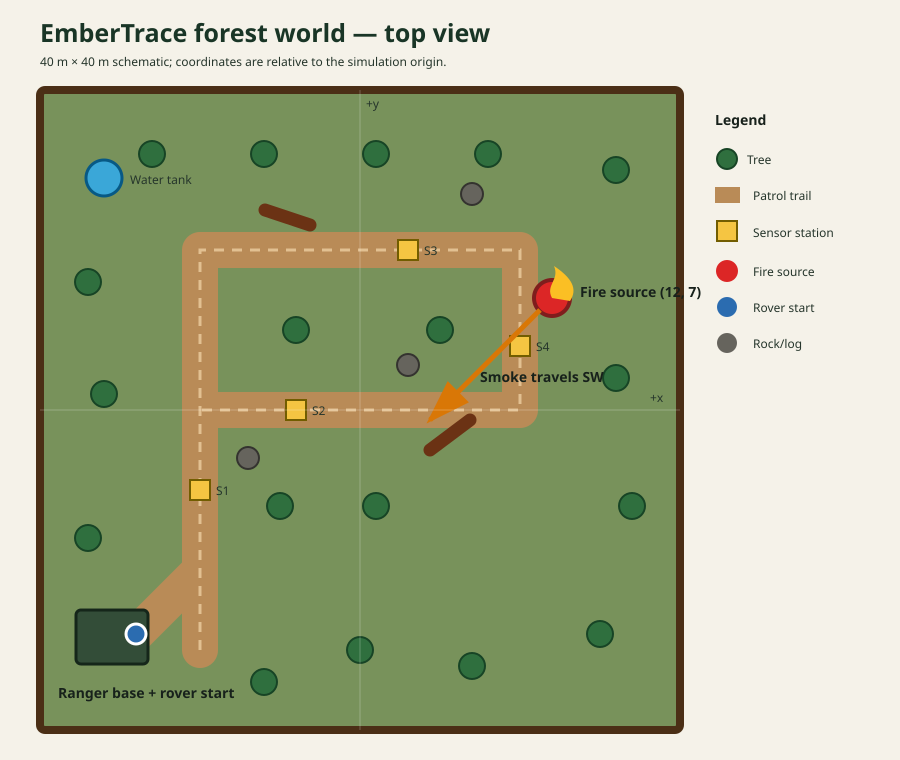

# Simulation environment

## Forest layout



`embertrace_forest.sdf` is a self-contained 40 m × 40 m environment. It contains:

- a ranger base and marked rover start area;
- a looped dirt patrol trail with a central junction;
- locally modelled trees rather than network-dependent Gazebo Fuel assets;
- rocks and fallen logs that create LiDAR obstacles;
- four environmental monitoring stations;
- a water tank/landmark;
- a fire-source model in an off-trail clearing;
- boundary fencing for visual and collision containment.

The environment is intentionally flat. Uneven terrain is a stretch goal because wheel slip and Nav2 costmap tuning can consume significant project time.

## Smoke model

The smoke field is generated in `embertrace_core`, not by Gazebo particles. For source position \((x_s,y_s)\), wind unit vector \(w\), robot offset \(d\), downwind distance \(u=d\cdot w\), and crosswind distance \(v\), the baseline concentration is approximately:

\[
C=C_0+A\exp(-u/L)\exp\left(-\frac{v^2}{2(\sigma+k u)^2}\right)+n
\]

The plume exists primarily downwind. A small source halo avoids a discontinuity at the source, and seeded Gaussian noise makes repeated tests reproducible.

Parameters are in `src/embertrace_bringup/config/embertrace.yaml`.

## Scenario design

Recommended final trials:

1. **Normal patrol:** source emission set below threshold; no alert should occur.
2. **Clear plume:** stable wind and moderate noise; robot should transition from patrol to track and localise the source.
3. **Signal loss:** higher noise or changed wind; robot should enter recovery and regain the plume.
4. **False visual cue:** orange object without smoke/heat; perception should not confirm a fire from vision alone.
5. **Emergency stop:** operator stops the mission during tracking; the action is cancelled and both motion controllers publish zero commands.

## Changing the hidden source

The current acceptance scene uses a source at (12, 7). A custom scene must move
the visible/thermal source and both mathematical fields together. Set `source_x`
and `source_y` in both `environment_simulator_node` and
`drone_environment_simulator_node` parameter blocks, for example:

```yaml
environment_simulator_node:
  ros__parameters:
    source_x: 10.0
    source_y: 7.0
```

Set the fire-state manager's `tree_pose` parameter in the bringup launch to the
same location; update the world's source include for scenarios that do not use
that manager. Restart the scene and verify native IR and gas readings before a
blind assessment. Editing only a gas-field coordinate leaves the thermal fire in
its old location and does not define a valid integrated trial. Decision nodes
must not receive these hidden coordinates.

## Added assets versus supplied archive

The supplied archive included a 25 m forest plane, visual walls, online Fuel trees/rocks, Husky and Parrot models, and dynamic Python demonstrations. EmberTrace:

- keeps and renames the useful Husky sensor/bridge structure;
- keeps the forest texture and required Husky meshes;
- uses a self-contained aerial sensor model for standalone missions and wind-selected automatic dispatch;
- removes online model dependencies from the main world;
- expands the world and adds project-specific infrastructure and hazards;
- replaces demonstration Python autonomy with separate C++ nodes;
- adds a mathematical plume that can be tested without rendering smoke physics.
